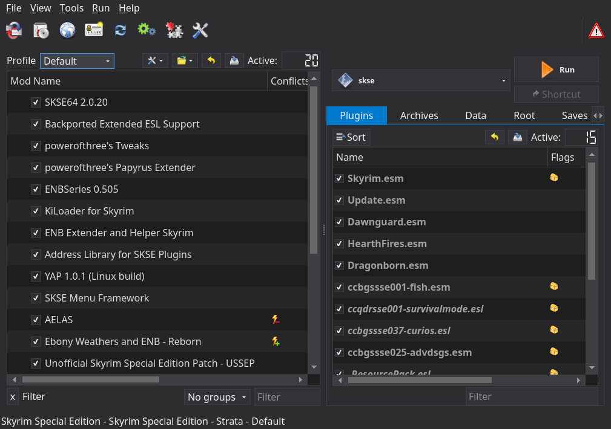

# Strata

A Linux-native mod manager for Bethesda games. It works like **Mod Organizer 2** (version 2.5.2, with the
MO2 *Leet Edition* additions) and reads and writes MO2's own instance files, so an existing MO2 or Fluorine
instance opens as it is. A Rust core does the work; a thin C++ Qt Widgets window keeps MO2's look, dialogs
and stylesheets. Mods stay in their own folders, like rock strata, and a FUSE overlay shows the game one
merged folder. Games run through Proton; the manager itself is native.



> **Be advised: Claude did it. I steered.** The code was written by an AI (Anthropic's Claude), directed,
> reviewed and tested in daily use by its author.

## What it does
- **MO2's window and workflow**: mod list with separators (nested *Sub-Separators*), drag and drop,
  categories and filters, conflicts, plugins with LOOT sorting, Data / Archives / Saves / Downloads tabs,
  mod information, profiles, executables, settings, the instance manager. MO2's `.qss` stylesheets work and
  reload live.
- **Instance compatibility**: `ModOrganizer.ini`, `modlist.txt`, `meta.ini`, `plugins.txt`,
  `loadorder.txt` and profile folders are MO2's formats, byte for byte. MO2, Fluorine and Strata can take
  turns on one instance.
- **Overlay without copying**: a case-insensitive FUSE overlay over the game folder, with writes going to
  Overwrite. **Root folders** (Root Builder): a mod's `Root/` files appear next to the game's exe (SKSE, ENB,
  DLL loaders), with no hardlinks or cleanup.
- **Proton, done for you**: new instances and prefixes from scratch (Proton choice, VC++, .NET, d3dx and
  friends), launch through the Steam Linux Runtime, Steam DRM handled.
- **Installers**: archives (7z / zip / rar), FOMOD with its dialog, BAIN, quick and manual installers, the
  Root sorter. **Nexus**: SSO login, `nxm://` links, the download queue, update checks.
- **Built in, no plugins needed**: BSA/BA2 extract and pack, the ini editor, previews (DDS, images, text),
  the Problems checks (missing masters, form 43, failed SKSE plugins), the crash log viewer and labeler,
  installing under a separator, CSV export, syncing Overwrite back into mods.
- **A command line for everything**: `strata deploy`, `strata run SKSE`, `strata install`, `strata sort`,
  `strata conflicts` and more, with `--json` output for scripts.

```
strata                   # the window
strata run "SKSE"        # mount, launch through Proton, unmount when the game exits
strata deploy            # mount the active profile over the game folder (tools run against it)
strata --help            # every command
```

## Games
| Game | State |
|---|---|
| Skyrim Special Edition (1.5.97 and later) | main target, used daily |
| Skyrim (Legendary Edition) | runs |
| Oblivion (classic) | experimental: built, not yet tested in game |

## Install
**Arch Linux** (and Arch-based distributions): build the package from `packaging/arch/PKGBUILD`:
```
git clone https://github.com/leetbuild/strata && cd strata/packaging/arch
makepkg -si
```

**From source** on any distribution, with Qt 6.5+ (Widgets, Network, Multimedia), Rust (stable, edition
2024), CMake 3.24+, Ninja and [Corrosion](https://github.com/corrosion-rs/corrosion):
```
tools/build.sh                   # → build/strata
tools/install-desktop.sh         # optional: desktop entry and icon for the current user
# or system-wide:
cmake -S . -B build -G Ninja -DCMAKE_BUILD_TYPE=Release -DSTRATA_BUILD_TESTS=OFF
cmake --build build && sudo cmake --install build
```

Runtime needs: `fuse3` (`fusermount3`), `7zip` (`7z`), Steam with a Proton (GE-Proton works well) and the
Steam Linux Runtime it asks for. Optional: `libsecret` (keeps the Nexus key in the keyring), `xdg-utils`.

## First start
Strata opens the instance manager when there is no instance yet. Open an existing MO2 / Fluorine instance
folder, or create one: pick the game, a name, a Proton and a prefix, and Strata sets up the prefix. The
[user guide](docs/USER-GUIDE.md) walks through it, including moving an instance over from Windows.

## Status
A young project: in daily use by its author on Skyrim SE, tested by a large suite (unit tests, an oracle that
compares with MO2's behaviour, a Qt Test program that clicks through the window, a check that starts the
game). Bugs are likely; please report them with the output of `strata info -i <instance>`.

Keep backups of instances you care about the first time you use Strata on them (`strata clone-instance`
makes a cheap copy on file systems with reflinks).

## For developers
[`docs/DESIGN.md`](docs/DESIGN.md) holds the rules Strata follows and why (instance files, the overlay,
Proton, the oracle checks); [`docs/ARCHITECTURE.md`](docs/ARCHITECTURE.md) describes the crates, the Rust/C++ bridge and the data flow; every crate has a
README. `tools/test.sh` runs everything that needs no game; `tools/e2e.sh` starts the game in a copy of a
prefix and checks SKSE loaded.

## Credits and licence
GPL-3.0. Strata reuses the forms, icons and stylesheets of Mod Organizer 2 and learned a lot from Fluorine
Manager; see [CREDITS.md](CREDITS.md).
